# Portfolio

I'm Guillermo Lechuga, an independent mobile developer based in Spain. I design, build and publish my own apps end to end, from game design and in-app purchases to analytics and store releases. Below are the apps I have published so far.

**At a glance:** 8 apps (7 live on the App Store, 3 already on Google Play and 3 more coming soon) · 5 games, 1 music app, 2 education apps · up to 9 languages · no accounts required, privacy-first.

---

<h2 id="alchemy-td"> Alchemy: Merge Tower Defense</h2>

*Merge elements into alchemical towers and defend the core.*

**[Download on the App Store](https://apps.apple.com/app/id6822802204)**

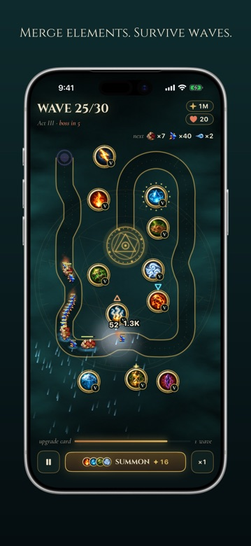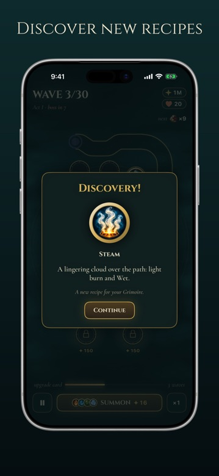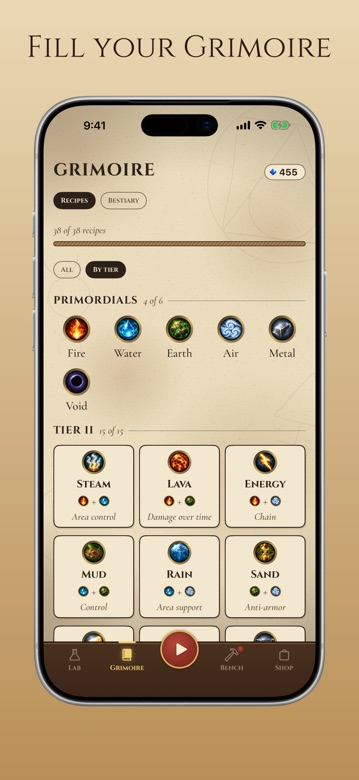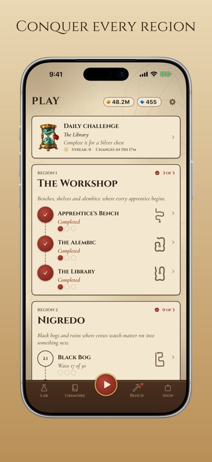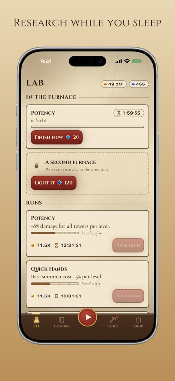

Merge Fire, Water, Earth and Air into over 40 alchemical towers, then hold the line against 30 waves of living-mineral monsters. Every merge is a discovery: each new recipe fills a page of your Grimoire, all the way to the Philosopher's Stone.

Runs are varied (pick bases, equip a bench of catalysts, choose upgrades every few waves) and progress continues while the game is closed thanks to an offline Lab and Alembic.

**Highlights**

- 15 maps across 5 regions, each ending in a three-phase Region Lord
- 40+ towers to discover by merging elements, plus a Bestiary of every monster
- Idle progress: Lab research with real-time timers, even offline
- Daily challenge with the same rules for everyone
- Offline play with iCloud sync across devices

<table><tr><th>Category</th><td>Games · Strategy</td></tr><tr><th>Released</th><td>Nov 2026</td></tr><tr><th>Platforms</th><td>iOS (iPhone & iPad)</td></tr><tr><th>Languages</th><td>EN, FR, DE, IT, PT, ES</td></tr><tr><th>Price</th><td>Free</td></tr></table>

[Support](/support/alchemy-td/) · [Privacy Policy](/legal/privacy/alchemy-td/)

---

<h2 id="from-one-to-ten"> From 1 to 10: Trivia Game</h2>

*The social trivia game where your ego is your biggest opponent.*

**[Download on the App Store](https://apps.apple.com/app/id6762570431)** · **[Get it on Google Play](https://play.google.com/store/apps/details?id=com.guillermolechuga.fromonetoten)**

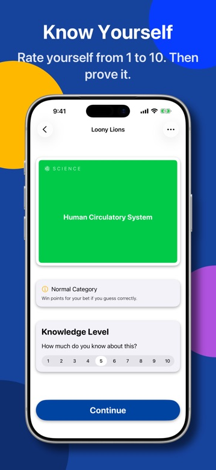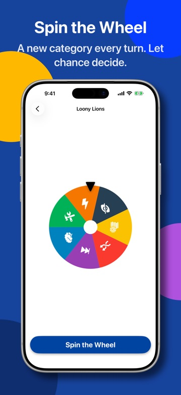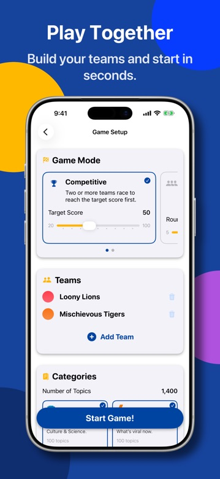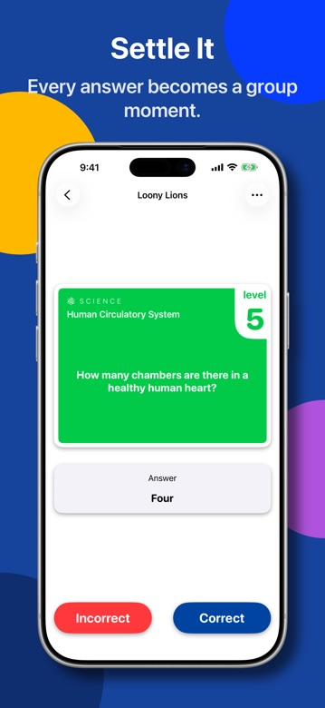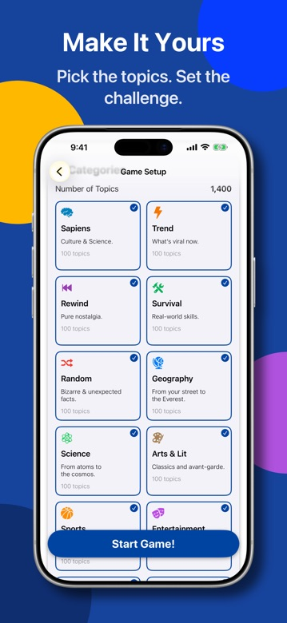

A pass-and-play party game inspired by the French format *Tu te mets combien ?*. Pick a topic, rate how confident you are from 1 to 10, then answer: the higher the level, the harder the question and the bigger the reward.

Designed for one phone and a group of friends, with special events like Blind Bet and Double Points to shake up the leaderboard.

**Highlights**

- 100 topics in the fully free Sapiens category
- Lite categories to try 10 topics each; Premium unlocks the full catalogue
- Pass-and-play for the whole party on a single device
- Zero-friction rules and offline play

<table><tr><th>Category</th><td>Games · Trivia, Board</td></tr><tr><th>Released</th><td>May 2026</td></tr><tr><th>Platforms</th><td>iOS (iPhone & iPad) and Android</td></tr><tr><th>Languages</th><td>EN, FR, RU, ES</td></tr><tr><th>Price</th><td>Free, Premium unlock (in-app purchase)</td></tr></table>

[Support](/support/from-one-to-ten/) · [Privacy Policy](/legal/privacy/from-one-to-ten/)

---

<h2 id="guess-what"> Guess What: Charades Party</h2>

*Modern charades for parties, family nights and classrooms.*

**[Download on the App Store](https://apps.apple.com/app/id6759858724)** · **[Get it on Google Play](https://play.google.com/store/apps/details?id=com.guillermolechuga.guesswhat)**

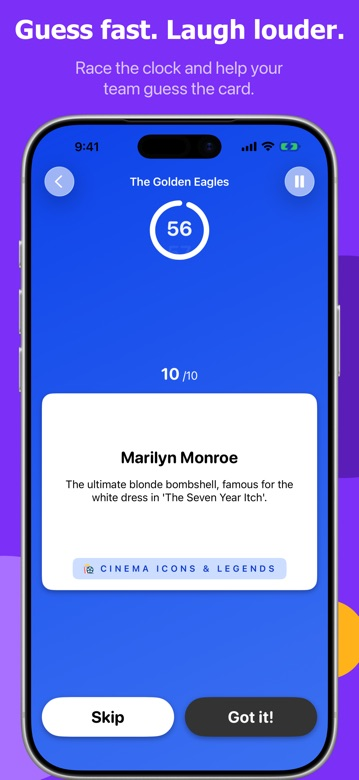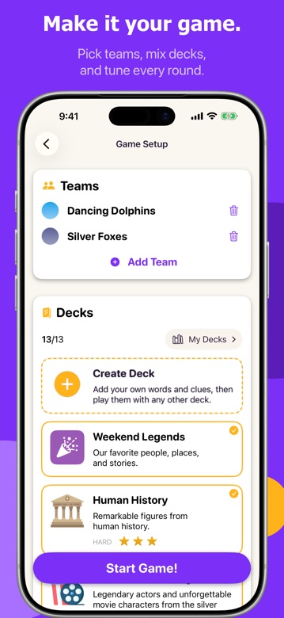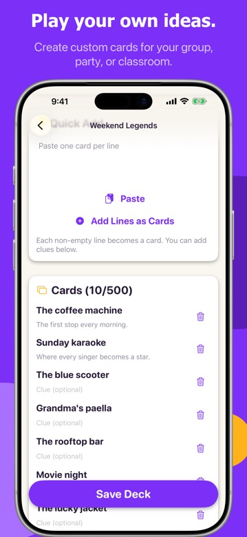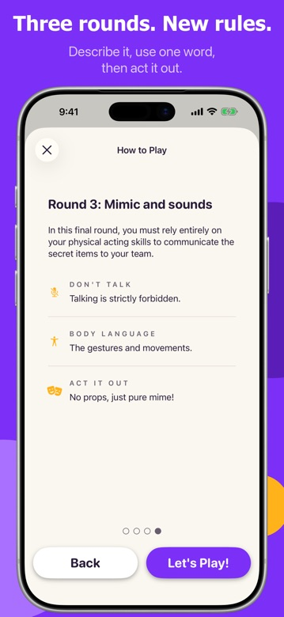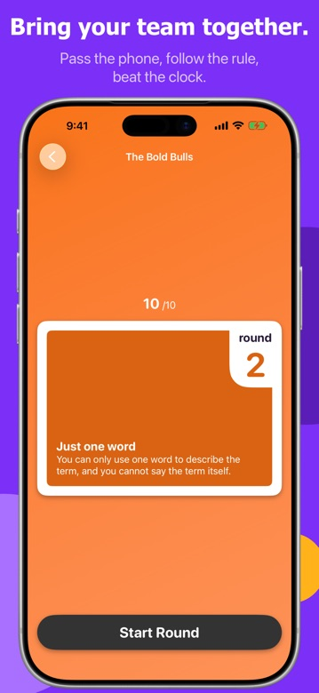

Choose a deck, act out or describe the word on screen, and score points before time runs out. Inspired by Time's Up and Monikers, it replaces paper cards and external timers with a fast, minimalist interface.

Players can also create their own decks for inside jokes, family challenges or classroom activities.

**Highlights**

- Dozens of themed categories, from movies and music to everyday objects
- Custom decks with your own words and clues
- Built to be passed around at dinners, parties and gatherings
- Open the app, pick a category and play in seconds

<table><tr><th>Category</th><td>Games · Word, Board</td></tr><tr><th>Released</th><td>Mar 2026</td></tr><tr><th>Platforms</th><td>iOS (iPhone & iPad) and Android</td></tr><tr><th>Languages</th><td>EN, FR, DE, IT, PT, RU, ZH, ES</td></tr><tr><th>Price</th><td>Free with four decks, Premium unlock (in-app purchase)</td></tr></table>

[Support](/support/guess-what/) · [Privacy Policy](/legal/privacy/guess-what/)

---

<h2 id="mind-gauge">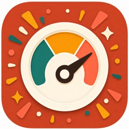 Mind Gauge: Guess the Spectrum</h2>

*A social guessing game about thinking on the same wavelength.*

**[Download on the App Store](https://apps.apple.com/app/id6778102245)**

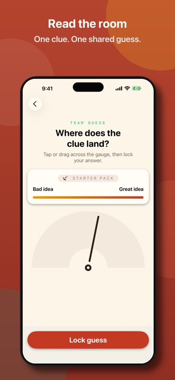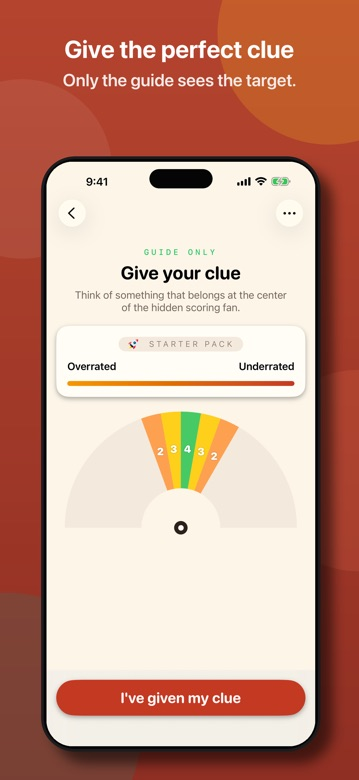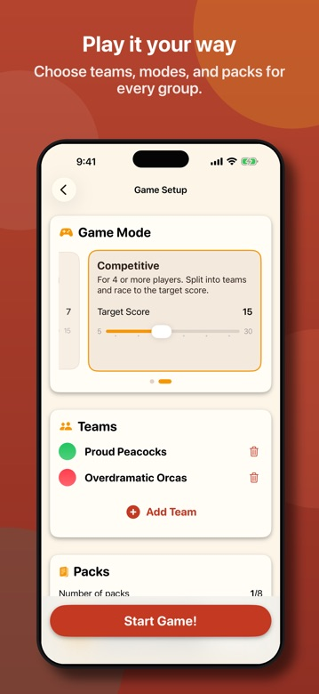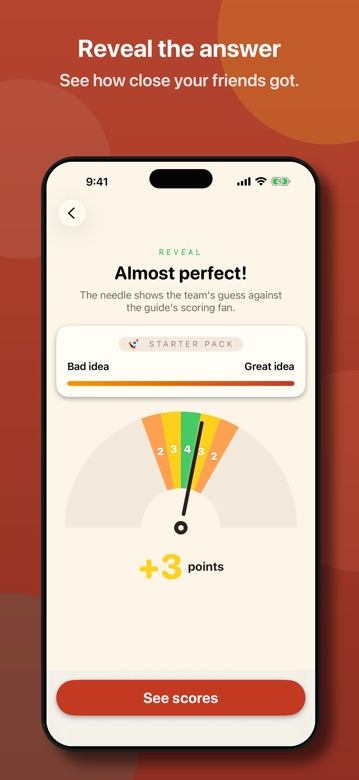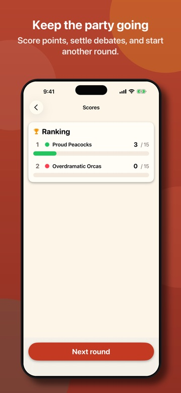

Each round shows a spectrum between two opposite ideas. One player secretly sees the target and gives a clue; everyone else debates it, moves the needle and reveals how close the group came.

Play in teams or cooperatively on a single device, with prompt packs covering food, sport, work, parties, history, pop culture and deeper topics.

**Highlights**

- Team and cooperative modes, pass and play
- Score up to four points for hitting the centre of the hidden target
- End-of-game stats: rankings, averages, bullseyes and best clue
- No account required

<table><tr><th>Category</th><td>Games · Board, Family</td></tr><tr><th>Released</th><td>Jun 2026</td></tr><tr><th>Platforms</th><td>iOS (iPhone & iPad)</td></tr><tr><th>Languages</th><td>EN, FR, DE, IT, PT, RU, ES</td></tr><tr><th>Price</th><td>Free, prompt packs as in-app purchases</td></tr></table>

[Support](/support/mind-gauge/) · [Privacy Policy](/legal/privacy/mind-gauge/)

---

<h2 id="jam-mate">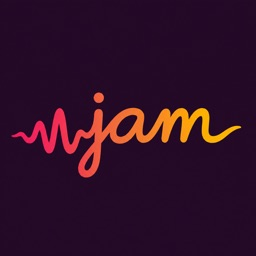 Jam Mate: AI Backing Tracks</h2>

*An original full band that builds itself around you, in any key, style and tempo.*

**[Download on the App Store](https://apps.apple.com/app/id6797809320)** · **[Get it on Google Play (coming soon)](https://play.google.com/store/apps/details?id=com.guillermolechuga.jammate)**

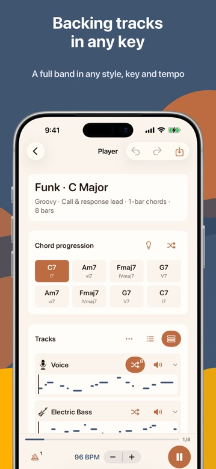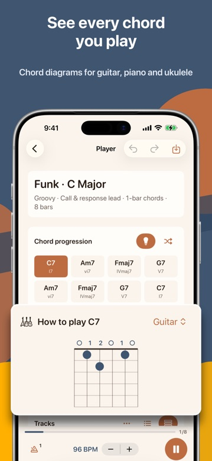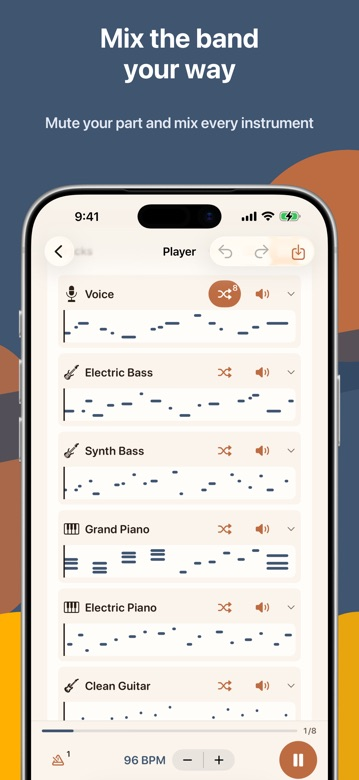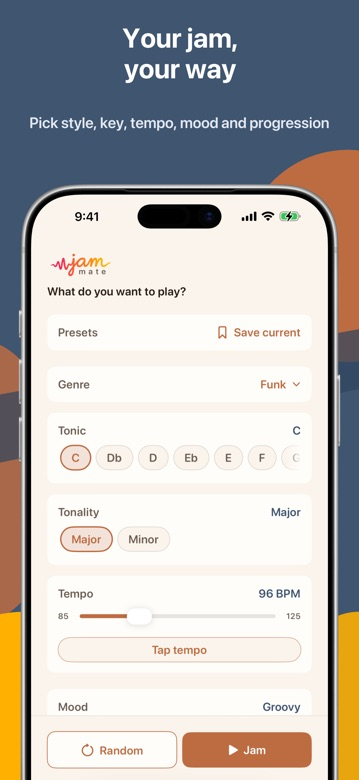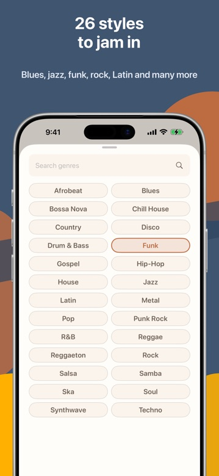

<video src="/recordings/jam-mate-foreground-480p.mov" controls muted loop playsinline preload="metadata"></video>

Practice chords, improvise solos and play along without hunting for the right track. Choose a musical direction and Jam Mate generates a full band (piano, bass, guitar, strings, lead voice and drums) in the key and tempo you want.

You can reshape the chord progression while playback continues, mute or solo instruments, and save jams and presets to come back to later.

**Highlights**

- 26 styles: blues, jazz, funk, rock, soul, reggae, Latin, hip-hop, techno and more
- Any key, major or minor, 60 to 180 BPM, with metronome and count-in
- Guitar, piano and ukulele chord hints
- Undo/redo, per-instrument shuffle and automatic evolving changes
- Saved jams, favourites and configuration presets; no account needed

<table><tr><th>Category</th><td>Music · Education</td></tr><tr><th>Released</th><td>Aug 2026</td></tr><tr><th>Platforms</th><td>iOS (iPhone & iPad); Android coming soon</td></tr><tr><th>Languages</th><td>EN, FR, DE, IT, JA, KO, PT, ZH, ES</td></tr><tr><th>Price</th><td>Free, Premium subscription (in-app purchase)</td></tr></table>

[Support](/support/jam-mate/) · [Privacy Policy](/legal/privacy/jam-mate/)

---

<h2 id="little-gp"> Little GP</h2>

*A racing game with a built-in track editor, ghost laps and leaderboards.*

**App Store: coming soon** · **[Get it on Google Play (coming soon)](https://play.google.com/store/apps/details?id=com.guillermolechuga.littlegp)**

<video src="/recordings/little-gp-480p.mov" controls muted loop playsinline preload="metadata"></video>

A small racing game with multiple cars, tracks and cups, medals to earn and ghost laps to beat. You can design your own circuits in the track editor.

Little GP shows no ads, needs no account and keeps all progress on your device.

**Highlights**

- Cars, tracks, cups, medals and personal records
- Ghost laps to race against your best times
- Track editor to build and play your own circuits
- Game Center leaderboards on iOS
- One-time premium unlock, no ads

<table><tr><th>Category</th><td>Games · Racing</td></tr><tr><th>Platforms</th><td>iOS and Android (coming soon)</td></tr><tr><th>Languages</th><td>EN</td></tr><tr><th>Price</th><td>Free, one-time premium unlock</td></tr></table>

[Support](/support/little-gp/) · [Privacy Policy](/legal/privacy/little-gp/)

---

<h2 id="cap-comp">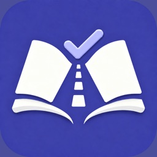 CAP y Competencia Profesional</h2>

*Exam preparation for professional drivers in Spain (Spanish-language app).*

**[Download on the App Store](https://apps.apple.com/app/id6814618593)** · **[Get it on Google Play](https://play.google.com/store/apps/details?id=com.guillermolechuga.capcomp)**

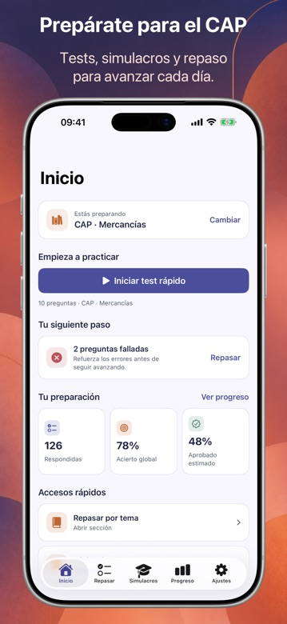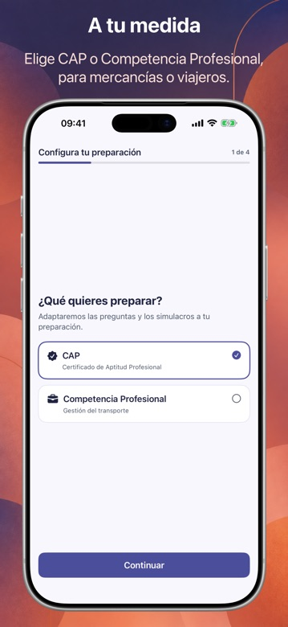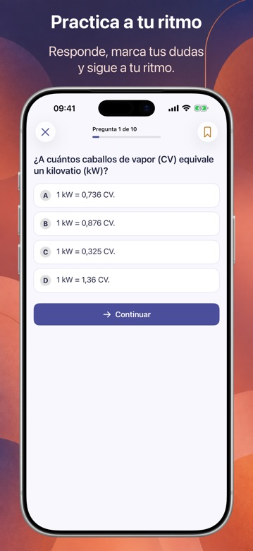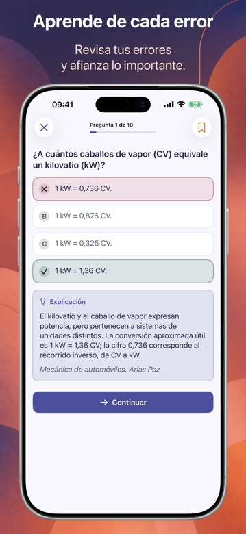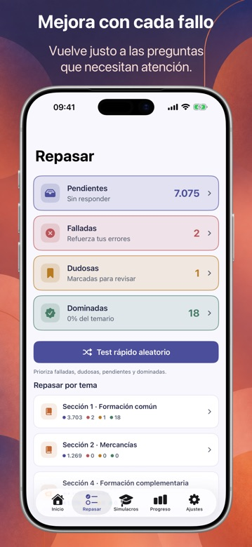

Study for the CAP and the Competencia Profesional transport exams, for goods or passengers. Pick your target exam, practise with quick tests or full mock exams and understand every answer with a clear explanation.

A review section sorts questions into pending, failed, doubtful and mastered, and progress charts show an estimated pass probability and accuracy per topic.

**Highlights**

- Content tailored to CAP or Competencia Profesional, goods or passengers
- Quick daily tests and full exam simulations
- Explanation for every answer and flagged-question review
- Estimated pass probability and progress over time

<table><tr><th>Category</th><td>Education</td></tr><tr><th>Released</th><td>Sep 2026</td></tr><tr><th>Platforms</th><td>iOS (iPhone) and Android</td></tr><tr><th>Languages</th><td>Spanish content</td></tr><tr><th>Price</th><td>Free, Premium unlock (in-app purchase)</td></tr></table>

[Support](/support/cap-comp/) · [Privacy Policy (ES)](/legal/privacy/cap-comp/)

---

<h2 id="armas-test">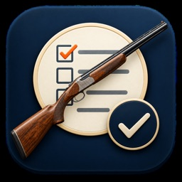 Licencia de Armas: ArmasTest</h2>

*Study for the Guardia Civil weapons licence exam (Spanish-language app).*

**[Download on the App Store](https://apps.apple.com/app/id6811419772)** · **[Get it on Google Play (coming soon)](https://play.google.com/store/apps/details?id=com.guillermolechuga.armastest)**

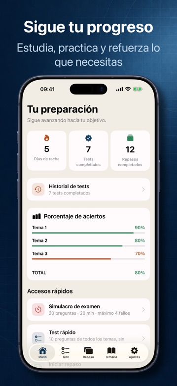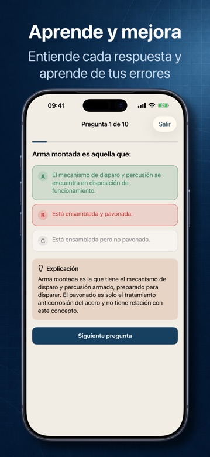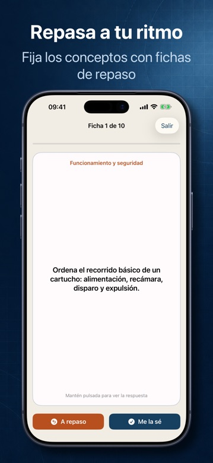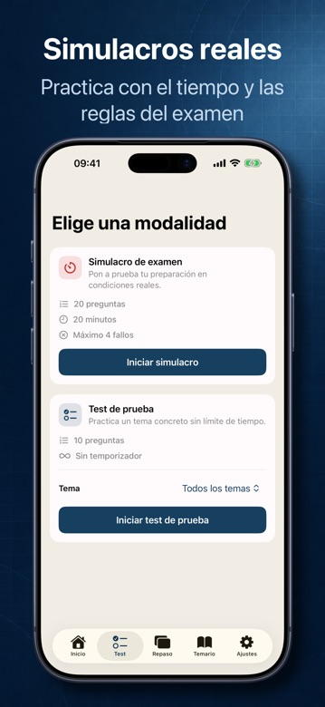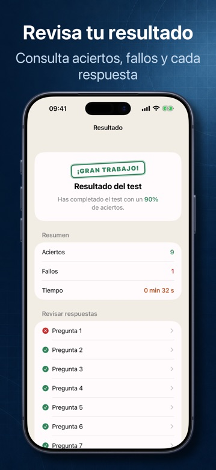

Prepare the official Guardia Civil weapons licence exam (permits D, E, F and hunting) with up-to-date multiple-choice questions and a detailed explanation for every answer.

Flashcards, mock exams and per-topic accuracy tracking show what to review next, and everything works offline.

**Highlights**

- Questions organised by permit: D, E, F and hunting
- Explanations for correct and incorrect answers
- Flashcards for key regulations and realistic exam simulations
- Accuracy tracking by topic; offline study

<table><tr><th>Category</th><td>Education</td></tr><tr><th>Released</th><td>Sep 2026</td></tr><tr><th>Platforms</th><td>iOS (iPhone); Android coming soon</td></tr><tr><th>Languages</th><td>Spanish content</td></tr><tr><th>Price</th><td>Free, Premium unlock (in-app purchase)</td></tr></table>

[Support](/support/armas-test/) · [Privacy Policy (ES)](/legal/privacy/armas-test/)

---

## Get in touch

Questions, collaborations or press: each app has its own contact address on its [support page](/support/). Legal information is available in the [Privacy and Terms section](/legal/).
